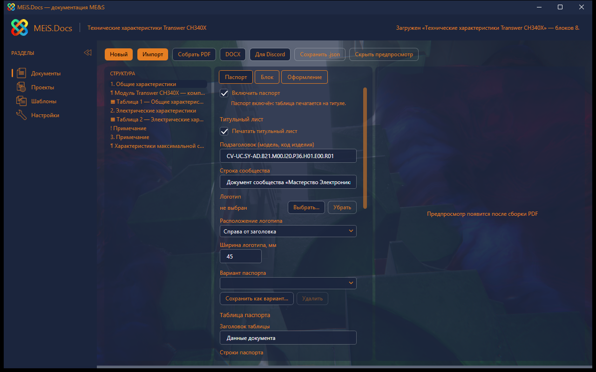
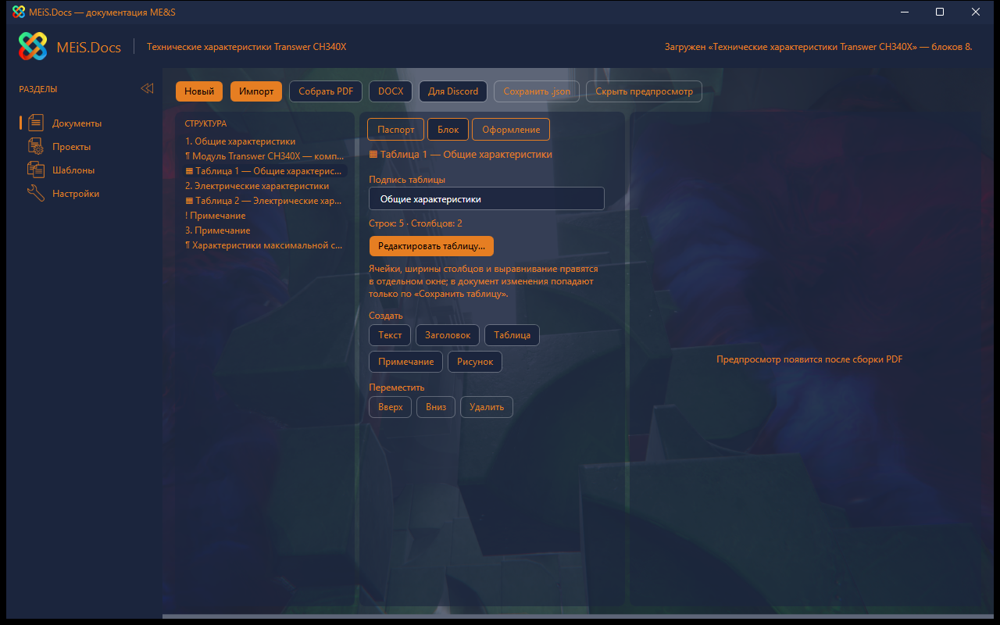

# MEiS.Docs — документация ME&S

Редактор и генератор документации сообщества **«Мастерство Электроники и Схемотехники» (ME&S)**.
Windows-приложение на WPF: импорт `.docx`/`.json`, паспорт документа, титульный лист, блоки,
таблицы (включая импорт из Excel), рисунки, сборка **PDF**, экспорт **DOCX** и постов для Discord.

**[Скачать MEiS.Docs 1.0.0](https://github.com/AskarGO/MEiS.Docs/releases/latest)**

## Возможности

- Импорт `.docx` и `.json` (`meis-doc/1`), создание документа из листа Excel.
- Паспорт документа, титульный лист, варианты паспорта и шаблоны титула.
- Блоки: заголовки, текст с разметкой, списки, таблицы, рисунки, примечания, код, разрывы.
- Таблицы: ширины столбцов в процентах, выравнивание, перенос через страницу с повтором шапки.
- Рисунки: PNG/JPEG/BMP/GIF/TIFF, авто-размеры, выравнивание, подпись, относительные пути.
- **PDF** с оглавлением, колонтитулами и страницами разной ориентации (эталон).
- **DOCX** своим OOXML-кодом, **пост для Discord**.
- Шаблоны документов, библиотека проектов, темы оформления.

## Требования

- Windows 10 (1903+) или Windows 11, x64.
- **.NET 10 не нужен** — установщик self-contained.
- **WebView2 Runtime** рекомендуется: без него не собирается PDF (обычно уже установлен в Windows 11).

## Установка

1. Скачайте `setup.exe` из [Releases](https://github.com/AskarGO/MEiS.Docs/releases/latest).
2. Запустите, подтвердите UAC — установка для всех пользователей.
3. Примите лицензионное соглашение и выберите папку (по умолчанию `C:\Program Files\MEiS.Docs`).
4. Нажмите «Установить»; ярлык появится в меню «Пуск» и на рабочем столе.

Тихая установка:

```powershell
setup.exe /S /ACCEPTEULA=1 "/DIR=C:\Program Files\MEiS.Docs" "/LOG=%TEMP%\meis-setup.log"
```

Установщик **не подписан**, поэтому SmartScreen может показать «Неизвестный издатель» —
нажмите «Подробнее» → «Выполнить всё равно». SHA-256 указан ниже и в `setup.exe.sha256`.

## Данные

Все данные хранятся **рядом с программой**, в `%AppData%` ничего не пишется:
`settings.json`, `documents/`, `projects/`, `templates/`, `passports/`, `titles/`, `images/`,
`fonts/`, `cache/`, `backup/`, `webview2/`.

При удалении данные по умолчанию **сохраняются**. Полное удаление:
`uninstall.exe /S /PURGEDATA=1`.

## Проверка целостности

- `setup.exe` — 71 249 920 байт
- SHA-256: `00b0f9c7e85208ce22e860287042ade05203d736c328561493188433b1681143`

```powershell
Get-FileHash .\setup.exe -Algorithm SHA256
```

## Скриншоты





## Лицензия

Проприетарное программное обеспечение, бесплатное для использования сообществом ME&S.
Полный текст — [LICENSE.md](LICENSE.md) (и `License.rtf` в установщике).

## Исходный код

Исходники ведутся в приватном репозитории и в этот публичный репозиторий не входят:
здесь только готовые сборки и документация для пользователей.
